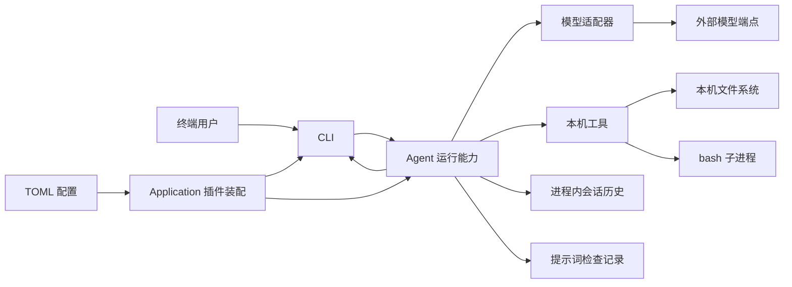
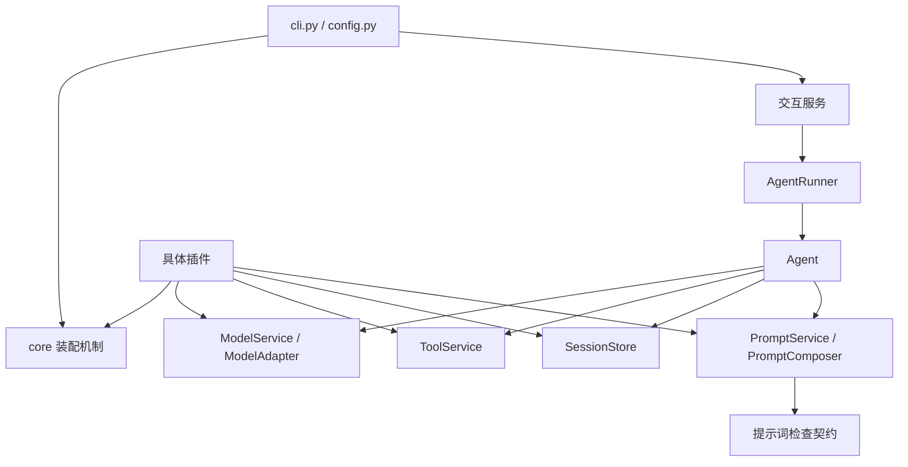
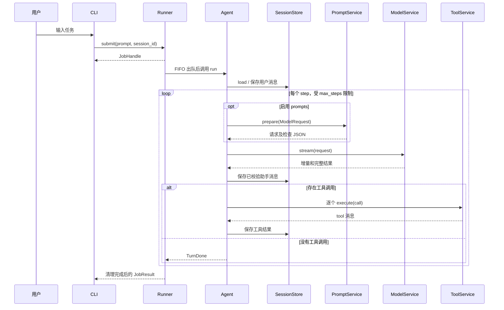

# 架构文档：当前系统如何组织

本文面向第一次完整阅读本项目源码的开发者，解释系统由哪些部分组成、各部分为什么分开，
以及一次输入如何经过模型和工具变成输出。实现细节见配套的
[当前实现设计文档](implementation-design.md)。

核对日期：2026-10-28。本文描述当前工作区的实现，不把路线规划或数据契约中的目标能力
视为现有功能。源码是实现事实；下文的设计取舍是对现有结构及其效果的解释。

阅读顺序：项目边界 → 模块分层 → 插件装配 → 执行链 → 数据与状态 → 并发和生命周期。
最后可以按阅读练习回到代码，逐个验证自己的理解。

## 1. 项目定位与实现范围

项目提供可嵌入其他 Python 工程的通用内核与基础设施，
模型、工具、提示词、存储和交互方式由插件装配；业务机器人与专项评测由外围工程提供。
示例里的工作助手提示词属于场景配置；核心 Agent 循环不固定角色。

本项目中的 Harness 可以理解为围绕模型运行的一组机制：

1. 接收任务，确定使用的模型和能力。
2. 将历史、提示词和工具定义组织成请求。
3. 处理模型输出，校验并执行工具调用。
4. 把完整消息与工具结果写入历史，再决定是否继续请求模型。
5. 管理排队、预算、结束、失败、取消和资源释放。

| 领域 | 当前已经实现 | 当前没有实现 |
| --- | --- | --- |
| 装配 | TOML 显式加载、服务注册、依赖排序、清理 | 自动发现、热卸载、插件市场 |
| 模型 | OpenAI Chat Completions 适配器、DeepSeek 兼容配置、离线 demo | 任意供应商协议的通用兼容 |
| 执行 | 流式文本/思考、工具循环、步数限制、取消 | 自动重试、并行工具执行、通用 hook 调度 |
| 编码能力 | UTF-8 文件读写与替换、非交互 bash | 图片工具、持久终端、独立编码任务评分 |
| 上下文 | 内存历史、显式提示词来源、组装结果检查 | 自动规则发现、压缩、跨进程会话恢复 |
| 交互 | CLI 单次输入、交互模式、有界 FIFO 排队 | Web 服务、网络重连、单 job 取消接口 |
| 验证 | 离线行为测试、模拟 HTTP 的 SDK 集成测试 | 公开验证集运行器和成绩报告 |

本篇和设计文档主要回答“现在如何工作”；具体工程可从
[嵌入式查询示例](../examples/embedded_query.py)开始添加自己的工具与入口。

## 2. 系统边界

当前运行单元是一个 Python 进程，主要工作在一个 asyncio 事件循环中。
文件操作通过工作线程执行，bash 通过子进程执行；它们不改变 Agent 核心的异步调用接口。

图中的外部访问有明确归属：模型适配器负责网络与认证，本机工具负责文件与命令，CLI 负责终端。
Agent Loop 不直接构造 HTTP 请求，也不直接读写项目文件。

同时需要认清当前边界的强度：

- 插件工厂是被导入并执行的可信 Python 代码，配置模块路径不是受限脚本。
- `local_tools.cwd` 决定相对路径和 bash 的启动目录，不限制当前用户可访问的路径。
- bash 继承进程环境。提示词规则和工具 JSON Schema 都不提供操作系统级隔离。
- `--check` 会完成插件启动，但内置插件不会因此调用模型；它不是对任意第三方插件副作用的保证。
- 正常进程退出后，内存历史和任务队列消失；提示词 JSON 只有调用者主动保存后才留下文件。

## 3. 模块分层与依赖方向

| 模块 | 核心对象 | 职责 |
| --- | --- | --- |
| `config.py` | `AppConfig`、`PluginSpec` | TOML 校验、导入插件工厂、创建应用 |
| `core/` | `Application`、`PluginContext`、`Registry`、`EventBus` | 能力装配、服务查找、生命周期和观察通知 |
| `llm/` | `ModelRequest`、`Message`、`ModelService`、`ModelAdapter` | 框架内的消息与模型协议 |
| `tools/` | `ToolService`、`Tool`、`FileTools`、`BashTool` | 注册、参数校验、执行与本机能力实现 |
| `storage/` | `SessionStore` | 会话历史读写接口 |
| `prompts/` | `PromptService`、`PromptComposer`、`PromptRecorder` | 请求组装、来源记录和结果校验 |
| `contracts/v1/` | `PromptInspection` 等 | 当前提示词检查的版本化 JSON 类型 |
| `agent/` | `Agent`、`Runner` / `JobReceipt`、`AgentRunner` | 一轮任务循环、调度契约及默认 FIFO 实现 |
| `plugins/` | 各个 `*Plugin` 与工厂 | 将能力创建、注册到应用；也容纳部分具体实现 |
| `cli.py` | `main()`、`run()` | 进程参数、装配启动和模式选择 |

目录名不代表“这个目录只放接口”。例如 `tools/` 同时有服务接口和文件/命令实现，
`plugins/openai_chat.py` 同时包含适配器和注册它的插件，`plugins/cli.py` 包含 CLI 实现。
阅读时先看对象的职责，再看文件位置。

以下箭头表示“依赖或调用”，不是数据存储关系：

`core/` 不导入 Agent、模型或具体工具。Agent 通过构造参数取得服务，不在循环里按供应商名称分支。
新增适配器或工具的通常路径是注册到已有服务；替换存储或组装器的通常路径是替换服务提供插件。

这也解释了为何存在两种“核心”：`core/` 是装配机制，`agent/loop.py` 是任务执行算法。
执行算法本身同样通过插件装配，不拥有绕过其他能力边界的特权。

## 4. 插件、服务和实现对象的关系

三个概念应分开理解：

- **实现对象**承担行为，例如 `OpenAIChatAdapter`、`MemoryStore`、`CLI`。
- **服务**是消费者取得能力的入口，例如 `MODELS`、`SESSIONS`、`INTERACTION`。
- **插件**负责创建对象、注册能力、声明依赖并登记清理，例如 `MemoryPlugin`。

以存储为例：`MemoryPlugin.name` 是 `storage`，它向 `SESSIONS` 注册一个 `MemoryStore`。
Agent 插件声明依赖插件名称 `storage`，启动时按服务键 `SESSIONS` 取得对象，
再将它传入 `Agent`。模块名 `memory`、插件名 `storage` 和服务名 `sessions` 含义不同。

当前配置中的依赖关系如下。`requires` 的约束只涉及列出的插件名：

| 插件名 | `requires` | 提供或注册的能力 |
| --- | --- | --- |
| `models` | 无 | `MODELS` → `ModelService` |
| `openai_chat` / `demo` | `models` | 向 `MODELS` 注册对应适配器 |
| `tools` | 无 | `TOOLS` → `ToolService` |
| `clock` / `local_tools` | `tools` | 向 `TOOLS` 注册时钟或四个本机工具 |
| `storage` | 无 | `SESSIONS` → `MemoryStore` |
| `prompts` | 无 | `PROMPTS` → `PromptService` |
| `agent` | `models`、`tools`、`storage`；启用时另需 `prompts` | `AGENT` → `Agent` |
| `runner` | `agent` | `RUNNER` → `Runner` 协议；默认创建 `AgentRunner` 并启动 worker |
| `cli` | `runner` | `INTERACTION` → `CLI` |

Agent 不直接依赖 `openai_chat` 或 `local_tools`。模型路由和工具列表由服务注册结果决定；
依赖排序保证服务提供者先启动，具体配置仍需把需要的能力插件装配进去。
Runner 消费者只依赖提交、关闭及只读回执协议；工程可替换为独立实现。
下文队列和调用时序描述默认 FIFO Runner；自定义实现须遵守[公共契约](plugins.md#公共契约)。
CLI 在应用启动后会验证选中的模型路由。

所有插件共享应用的 Registry 与 EventBus；每个插件有自己的清理栈。
同一服务名不允许多个提供者同时注册。替换存储等服务时，应替换原插件配置，
而不是同时装配两个同名插件或同名服务。

## 5. 执行入口、任务和循环

CLI 解决输入与显示问题，Runner 解决排队与结果问题，Agent 解决一轮任务内部的模型/工具循环。

图中循环在没有工具调用时结束；达到步数上限或出现模型错误时走失败路径。
通知与终端显示省略在图外；交互模式按完整行输出，单次模式逐块输出，详见设计文档。

一个 job 对应一次提交，一轮 turn 对应一次 `Agent.run()`。
一个 step 是一次模型请求加上该次返回的工具批次。
模型要求三个工具不代表三个 step；这三个工具按顺序完成后，下一次模型请求才进入下一步。

Runner 只会将正常结束的执行标为 `succeeded`。这不是编码任务正确性的判定：
真实代码是否修好，需要未来评测层检查产物和独立测试结果。

## 6. 数据归属与三种不同的结果

| 数据 | 所有者或载体 | 何时产生与保留 |
| --- | --- | --- |
| 排队输入 | `AgentJob` / Runner 队列 | `submit()` 固定提交时间；尚未进入会话 |
| 会话历史 | `MemoryStore` 中的 `Message` 列表 | 用户任务出队后、完整助手消息与工具结果确认后保存 |
| 本次模型上下文 | `ModelRequest` | 每个 step 重新准备，可经 PromptComposer 修改 |
| 时间状态 | `ModelRequest.runtime` | 启用 prompts 时每请求采样当前时间，保留任务提交时间；组装器渲染并记录来源 |
| 供应商载荷 | `OpenAIChatAdapter.stream()` 的局部对象 | 请求前序列化；当前不保存检查快照 |
| 流式显示内容 | `TextDelta`、`ThinkingDelta` 等事件 | 逐块消费；失败时已有显示不自动撤回 |
| 提示词检查 | `PromptInspection` 的 JSON 字符串 | 每次组装生成；是否含正文由采集选项决定 |
| 任务终态 | `JobHandle` 持有的 `JobResult` | 执行及流清理后确定；没有集中查询目录 |

尤其要区分：

1. **组装成功**：有合法请求和来源记录，不证明模型已经被调用。
2. **模型/任务执行成功**：响应完整、循环正常结束，不证明任务满足外部要求。
3. **评测通过**：产物通过独立评分。当前还没有这一层。

会话历史也不等于模型上下文。内置组装器主要扩充 system；自定义组装器可以调整某次请求，
但返回的请求不会自动覆盖 SessionStore。预览同样只读历史，不提交任务。

## 7. 并发、顺序和资源生命周期

当前采用多处明确的串行边界，各自解决不同问题：

| 机制 | 范围与目的 |
| --- | --- |
| Runner 单 worker | 所有会话的 job 按 FIFO 顺序执行 |
| Agent 实例内按 `session_id` 加锁 | 同会话的 run/inspect 互斥至清理完成；不同会话可并发 |
| 工具批次顺序执行 | 一个工具结果保存后再处理下一个调用 |
| FileTools 的修改锁 | 同一 FileTools 实例的 write/edit 串行，读操作独立 |
| EventBus 顺序 await | 同一通知的观察者按注册顺序执行 |

Agent 的会话锁限于同一实例和事件循环，不提供跨 Agent 实例或跨进程的事务保证。
外部调度层可并发消费不同会话的流，并负责并发数量和已启动任务的生命周期；默认 Runner 仍串行。
此时模型适配器、工具、提示词组装器、存储及事件观察者可能被并发调用，共享资源由各实现保护。
模型调用和工具执行期间，CLI 的异步输入仍可继续接受下一条消息；消息会排队，
不会注入正在执行的 step。

资源所有权从外到内依次是：Application → 插件清理栈 → Runner worker / 服务对象
→ 单次模型流或工具操作。取得资源后立即登记清理，退出时先释放使用者，再释放依赖。

| 资源 | 当前负责清理的一方 |
| --- | --- |
| 注册服务、事件订阅、适配器和工具 | 对应插件的 `PluginContext` 清理栈 |
| 队列 worker 与已接受任务 | `AgentRunner.close()` |
| 嵌套异步生成器 | 消费者使用 `contextlib.aclosing` |
| SDK client 与模型 stream | 适配器内的异步上下文管理器 |
| 文件工作线程 | `finish_before_cancel` 等待已开始的操作结束 |
| bash 与同组后代进程、管道 | `BashTool._cleanup()` |

取消表示停止继续执行并完成必要清理，不表示撤销副作用。
文件线程不能通过取消等待者直接停止，所以取消可能晚于请求时刻返回；
命令清理以进程组为边界，主动脱离进程组的程序不受此保证覆盖。

## 8. 当前设计的取舍

| 选择 | 带来的效果 | 当前代价或边界 |
| --- | --- | --- |
| 显式插件装配 | 依赖和能力来源可从配置追踪 | 使用者需要列出所需插件 |
| 供应商类型留在适配器 | Agent 与工具无需认识 SDK | 兼容差异由适配器维护，不能推断支持所有端点 |
| 流事件与最终消息分开 | 显示可及时进行，历史只保存完整结果 | 观察者必须识别增量与终态，避免重复累计 |
| 顺序执行、进程内存储 | 调用链容易阅读，时序测试可控 | 无并行吞吐、崩溃恢复或持久化会话 |
| 单次请求、不自动重试 | 部分输出和副作用不会被无声重放 | 临时网络失败直接结束当前任务 |
| 工具错误作为模型输入 | 模型可以根据失败信息调整动作 | 工具结果目前是字符串加 `is_error`，状态表达有限 |
| 可替换提示词与强制来源覆盖 | 能解释 assembled 请求从何而来 | 尚不能检查 SDK 转换后的实际载荷 |
| EventBus 只做观察 | 普通观察者错误不替代执行结果 | 慢观察者阻塞执行，无可靠投递、回放或拦截语义 |

实现中的预留注释只表示潜在扩展位置，不代表已经提供 hook API。
详细的版本化消息、Trace、网络身份与恢复约束仍属于
[数据契约设计基线](data-contracts.md)，当前仅落地提示词检查子集。

## 9. 如何对照源码学习

建议按下面的顺序读，每次只追踪一个完整行为：

| 轮次 | 阅读入口 | 读完应能回答 |
| --- | --- | --- |
| 1 | [loop.py](../src/my_own_agent/agent/loop.py)、[llm/types.py](../src/my_own_agent/llm/types.py) | 一轮何时开始、何时保存历史、何时调用工具、何时结束？ |
| 2 | [config.py](../src/my_own_agent/config.py)、[core/plugins.py](../src/my_own_agent/core/plugins.py) | 一个配置块如何变成 Agent 可调用的服务？ |
| 3 | [runner.py](../src/my_own_agent/agent/runner.py)、[plugins/cli.py](../src/my_own_agent/plugins/cli.py) | 为什么模型运行时还可以输入？取消等待为什么不等于取消任务？ |
| 4 | [openai_chat.py](../src/my_own_agent/plugins/openai_chat.py)、[tools/service.py](../src/my_own_agent/tools/service.py) | 请求如何离开框架？模型给出的 JSON 如何变成实际动作？ |
| 5 | [prompts/service.py](../src/my_own_agent/prompts/service.py)、[composer.py](../src/my_own_agent/prompts/composer.py) | 历史、assembled 请求和检查快照有哪些区别？ |
| 6 | [filesystem.py](../src/my_own_agent/tools/filesystem.py)、[shell.py](../src/my_own_agent/tools/shell.py) | 失败和取消时，文件线程、命令与管道由谁收尾？ |

每轮都可对照 [实现设计文档](implementation-design.md) 中的步骤、状态表和测试索引。
最适合先跑的例子是 `examples/demo.toml`：它不调用外部模型，但完整经过插件、循环、工具、
历史和 CLI。之后再对照真实适配器，能清楚区分通用循环与供应商协议处理。
