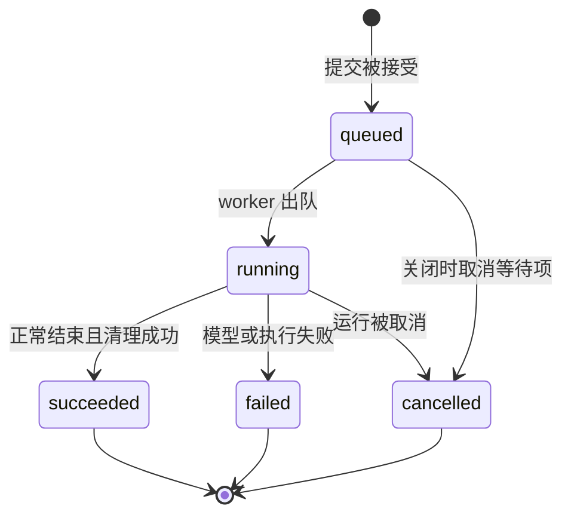

# 当前实现设计文档：从入口到资源清理

本文配合 [架构文档](architecture.md) 阅读，逐项解释当前函数、数据结构和执行路径。
核对日期：2026-09-11；范围为当前工作区源码及其离线测试。
以下字段表和流程用于辅助阅读，类型定义、默认值和实现仍以所链接源码为准。

内容导航：

1. [启动与配置](#1-启动与配置)
2. [插件生命周期、服务注册和事件观察](#2-插件生命周期服务注册和事件观察)
3. [运行时数据结构](#3-运行时数据结构)
4. [Agent 循环与历史提交](#4-agent-循环与历史提交)
5. [Runner 排队与 CLI](#5-runner-排队与-cli)
6. [模型适配与流解析](#6-模型适配与流解析)
7. [工具调度、本机文件与 bash](#7-工具调度本机文件与-bash)
8. [提示词组装和检查契约](#8-提示词组装和检查契约)
9. [取消与失败的完整路径](#9-取消与失败的完整路径)
10. [验证入口、测试索引与实现边界](#10-验证入口测试索引与实现边界)

## 1. 启动与配置

源码：[包入口](../src/my_own_agent/__init__.py)、[模块入口](../src/my_own_agent/__main__.py)、
[cli.py](../src/my_own_agent/cli.py)、[config.py](../src/my_own_agent/config.py)。

### 1.1 从命令进入应用

`pyproject.toml` 将 `my-own-agent` 指向 `my_own_agent:main`。
包内的 `main()` 延迟导入 `cli.main()`；`python -m my_own_agent` 也进入同一路径。

```text
main()
  argparse 解析参数
  asyncio.run(run(args))
    load_config(args.config)
    async with create_application(config) as app
      取得 AGENT
      应用 --model 覆盖并验证模型路由
      根据模式检查、预览或调用 INTERACTION.run
    退出 Application，释放插件资源
  使用退出码结束进程
```

这意味着 CLI 参数处理是进程外壳，实际交互是 `INTERACTION` 服务。
现有外壳仍明确需要 `AGENT`，正常交互路径还需要 `INTERACTION`；它不是任意插件组合的通用命令宿主。

### 1.2 配置解析的三个层次

| 层次 | 实现 | 校验内容 |
| --- | --- | --- |
| 文件格式 | `tomllib.load()` | TOML 能否解析 |
| 装配结构 | `AppConfig` / `PluginSpec` | 非空 plugins 列表、`module:factory` 格式、JSON 配置值 |
| 各插件配置 | `create_plugin(config)` 中的 Pydantic 模型 | 模型选项、步数、工作目录配置、队列容量等 |

工厂加载流程是 `import_module(module)` → `getattr(module, attribute)` → `factory(config)`。
返回值在加载器中只显式检查 `name` 是否为字符串；`Plugin` 是静态协议，
没有对任意工厂返回对象做完整运行时接口验证。

`DataModel` 默认 `extra="forbid"`，因此不接受未知字段。没有自定义配置的插件用
`DataModel.model_validate(config)` 拒绝非空配置。`ModelSpec.options` 是适配器拥有的 JSON 字典，
再由所选适配器校验其结构。

导入模块和调用工厂发生在 Application 的依赖校验之前。仓库约定工厂只解析配置，
但可信插件的 Python 代码并未受到强制副作用隔离；“启动前检查依赖”只保证还没有调用插件的 `start()`。

### 1.3 模式与退出码

| 选项或操作 | 当前行为 |
| --- | --- |
| `--config` | 默认读取 `agent.toml`，不自动从其他目录发现配置 |
| `--model` | 在应用已装配后覆盖 Agent 的模型别名，再验证路由 |
| `--check` | 完成插件启动并验证路由；不调用模型，不读取提示词 section 文件 |
| `--inspect-prompt` | 完整采集一次 assembled 预览，输出 JSON，不保存用户输入 |
| `--prompt` / `-p` | 提交一轮任务并等待结果，然后关闭 Runner |
| 不传 `--prompt` | 进入交互输入循环 |
| `--session` | 默认 `default`，只区分当前进程内历史 |
| `--show-prompt` | 每次组装的完整检查 JSON 输出到 stderr |
| `--show-thinking` | 将供应商返回的思考增量输出到 stderr |

`--check` 与 `--inspect-prompt` 互斥；它们在进入普通交互之前返回。
所有模式先启动配置中的插件，所以仍会检查本机工具的 cwd/bash、提示词服务的 cwd，
也会启动配置中的 Runner worker；内置插件在退出上下文时清理这些资源。

常规退出码是：0 为检查或执行成功；1 为任务失败或交互队列拒绝；2 为捕获到的配置/启动错误
或提示词预览失败；130 为 Ctrl-C。`main()` 只转换列出的异常类型，未处理的异常仍会向外传播，
不能把这些退出码解释成完整的异常分类协议。
配置 `ValidationError` 只显示字段路径与错误类型，避免打印输入值。

应用不自动加载 `.env`，真实调用时可由 `uv run --env-file .env` 提供环境变量。

## 2. 插件生命周期、服务注册和事件观察

源码：[core/plugins.py](../src/my_own_agent/core/plugins.py)、
[core/registry.py](../src/my_own_agent/core/registry.py)、[core/events.py](../src/my_own_agent/core/events.py)。

### 2.1 Application 的启动算法

`Application` 保存插件序列、共享 Registry/EventBus、已进入启动流程的插件列表和内部状态。

1. `start()` 只允许 `_state == "new"`。
2. `_ordered()` 先拒绝重复插件名，再通过深度优先遍历计算依赖在前的顺序。
3. `visiting` 检测环，`visited` 避免重复加入；缺少依赖立即报错。
4. 依赖校验完成后进入 `starting`。
5. 为每个插件创建 `PluginContext`，先加入 `_active`，再 `await plugin.start(ctx)`。
6. 全部启动成功后进入 `running`。

第 5 步的顺序保证“启动了一半的插件”也会被清理。无依赖冲突时的遍历顺序受配置列表顺序影响，
不是按名称排序。详细的内置插件依赖表见 [架构文档](architecture.md)。

### 2.2 清理与异常保留

`close()` 从 `_active` 末尾逐个取出插件，先调用 `plugin.stop(ctx)`，再调用 `ctx.close()`。
两部分各自捕获 `BaseException` 并继续清理其余资源；最后如有异常，统一抛出 `BaseExceptionGroup`。

启动异常触发同一套 `close()`。如果启动与清理都失败，保留二者；
应用上下文中的原始异常与退出清理异常也会共同保留。
没有资源剩余时再次 `close()` 可以返回；已关闭应用不能重新启动。
依赖图校验失败发生在状态变为 `starting` 之前，因而此时尚未开始插件生命周期。

### 2.3 PluginContext 与 LIFO 清理

每个 Context 拥有自己的 `AsyncExitStack`，但共享应用级服务和事件对象：

| 方法 | 行为 |
| --- | --- |
| `provide(key, service)` | 注册服务并立即登记注销回调 |
| `subscribe(topic, listener)` | 订阅事件并立即登记退订回调 |
| `defer(cleanup)` | 登记同步回调 |
| `defer_async(cleanup)` | 登记异步回调 |
| `close()` | 按登记顺序的反序执行回调 |

清理栈是资源归属机制，不是通用事务回滚。已经写入的文件或执行过的命令，不会因插件退出自动恢复。
目前大部分内置插件只覆盖 `start()`，资源释放依赖它们登记的回调。

默认 Runner 插件依次执行 `runner.start()`、登记 `runner.close`、注册 `RUNNER` 服务。
因此其 Context 清理时先注销服务键，再关闭持有的 Runner 对象；Agent 及其依赖仍未释放，
已接收任务可以在正常关闭路径中完成。
`RUNNER` 的类型为 `Runner` 协议，CLI 只依赖 `submit/close`。
启动方法属于具体实现，由插件管理，不要求其他调度器也提供 `start()`。

### 2.4 Registry 的类型与身份

`ServiceKey[T]` 将名称和静态类型关联，Registry 内部实际保存 `dict[str, object]`。
查找按 `key.name`，不是按 ServiceKey 对象身份；`get()` 中的 `cast(T, ...)` 服务于类型检查，
不做运行时接口验证。

重复服务名被拒绝。注销闭包只在当前对象仍是注册时的对象时删除，避免删除其他所有者的对象。
`ModelService.register()` 与 `ToolService.register()` 使用类似的可撤销注册方式。

### 2.5 EventBus 的准确语义

`emit()` 先复制当前监听器列表，再依注册顺序逐个 `await`。普通 `Exception` 只记录一条
不包含原始异常正文的 warning，后续监听器继续执行；`CancelledError` 等 `BaseException`
不在这个隔离范围内。

通知没有返回值合并、请求修改或拒绝执行协议。它不是 hook 调度器。
也没有持久化、事件序号、离线补发、慢消费者缓冲或去重；慢监听器会延迟发出通知的执行协程。

## 3. 运行时数据结构

源码：[llm/types.py](../src/my_own_agent/llm/types.py)、[agent/loop.py](../src/my_own_agent/agent/loop.py)、
[agent/runner.py](../src/my_own_agent/agent/runner.py)。

### 3.1 模型请求与会话消息

| 对象 | 主要字段 | 当前含义 |
| --- | --- | --- |
| `ModelSpec` | `adapter`、`model`、`options` | 别名对应的适配器、实际模型名和供应商选项 |
| `ModelRequest` | `model_alias`、`system`、`messages`、`tools`、`runtime` | 某次准备发送的框架请求 |
| `RuntimeState` | `current_time`、`timezone`、`user_submitted_at` | 每请求的当前时间快照、IANA 时区、固定的本任务提交时间 |
| `Message` | `role`、`content`、`thinking`、`tool_calls`、`tool_call_id`、`is_error`、`model_alias`、`submitted_at` | 一条历史消息；用户提交时间可空 |
| `ToolCall` | `id`、`name`、`arguments` | 已收集完整的调用，arguments 仍是原始 JSON 字符串 |
| `ToolDefinition` | `name`、`description`、`parameters` | 给模型展示的工具定义，参数是 JSON Schema 对象 |
| `Usage` | 输入、输出、缓存输入、推理 Token 数 | 单个用量事件的数据；不在核心自动累积 |

历史 Message 没有 system 角色，system 单独放在 ModelRequest 中。
Message 也不包含稳定 `message_id`、任务身份或结构化内容块。
当前供应商工具 ID 直接放在 `ToolCall.id` 并回填到结果中，只验证同一响应批次内唯一；
没有实现跨请求的框架工具 ID 映射。

Pydantic 的 `frozen=True` 限制字段重新赋值，但不递归冻结嵌套 dict。
模型路由、工具定义、提示词准备和内存存储在各自边界使用深复制，避免外部可变引用污染执行。
跨字段语义并非全部由类型定义保证：例如助手角色与 finish reason 的一致性由 Agent 再校验。

### 3.2 模型、Agent 和 Runner 三层事件

| 层次 | 事件 | 用途 |
| --- | --- | --- |
| 模型 | `TextDelta`、`ThinkingDelta`、`ToolCallDelta`、`UsageEvent` | 已观察到的流式信息 |
| 模型 | `ModelDone(message, reason)`、`ModelError(code, message, retryable)` | 完整模型结果或模型失败 |
| Agent 新增 | `PromptBuilt`、`ToolStarted`、`ToolFinished`、`TurnDone` | 组装、工具执行和一轮结束 |
| Agent 包装 | `AgentNotification(session_id, event)` | 通过 `agent.event` 发出 |
| Runner | `JobStarted(job)`、`JobEvent(job, event)`、`JobFinished(job, result)` | 通过 `runner.event` 增加任务关联 |

AgentEvent 包含原有 ModelEvent。Agent 不会把文本增量转换成另一份最终文本；
同一事件先经 `agent.event` 通知，再由生成器 yield 给 Runner，随后被包装为 `JobEvent`。
同时订阅两种 topic 的观察者会看到同一执行事实的不同包装，不能按两次模型输出累计。

### 3.3 身份与终态

`AgentJob` 包含 `job_id`、`session_id`、`prompt`、`submitted_at`；一次成功入队的提交有独立 job ID。
Runner 入队时采样带时区的 UTC 提交时间，执行时原样传给 Agent，避免排队跨日改变“今天”的参照。
消费者通过 `JobReceipt` 协议读取 job、state 并等待 result，不操作状态或完成方法。
默认 `JobHandle` 持有这个 job、当前状态和一个承载结果的 Future；工程可以提供自己的回执实现。
`JobResult` 的终态是 `succeeded / failed / cancelled`，成功带助手 Message，失败带 ModelError。

提示词检查另有 `build_id / request_id / snapshot_id`。这些 ID 目前只在检查记录内形成关联，
没有统一贯穿模型适配器、工具执行和 Trace。完整身份规范是后续设计，见
[数据契约](data-contracts.md)。

### 3.4 MemoryStore 如何保存历史

源码：[storage/service.py](../src/my_own_agent/storage/service.py)、
[plugins/memory.py](../src/my_own_agent/plugins/memory.py)。

SessionStore 只定义异步 `load(session_id)` 和 `save(session_id, messages)`。
MemoryStore 内部是 `dict[str, list[Message]]`：未知 session 返回空列表，load 对消息逐项深复制，
save 也先逐项深复制再替换该 session 的列表。调用者取得的历史可以修改，不直接改变存储。

这两个异步方法内部没有 I/O 或 await，实际工作是当前事件循环中的内存复制与赋值。
在现有单进程执行方式下，一次 save 替换整个快照；没有 append-only 日志、提交序号、磁盘文件或
历史分支。多进程共享持久存储需要额外的并发和提交语义，不能仅替换字典就获得。

## 4. Agent 循环与历史提交

源码：[agent/loop.py](../src/my_own_agent/agent/loop.py)。

### 4.1 run() 与 _turn() 的分工

`run()` 是可关闭的异步生成器。它拒绝空白输入，将传入的提交时间写入用户消息；未传入则在等待锁前采样。
随后持有本实例中该 `session_id` 的锁，以 `aclosing` 消费接收该用户消息的 `_turn()`，
逐个通知 `agent.event` 再 yield 事件。调用 `agent.run(...)` 本身还不执行任务，开始迭代才会执行。
直接消费时应使用 `async with aclosing(agent.run(...))`，使提前退出也关闭内部资源。

同一会话的下一轮在当前流关闭、取消清理和历史修复完成后才能读取历史；等待锁时被取消不写入用户消息。
不同会话可并发，具体并发数量和排队策略由外部调度层决定。锁缓存使用弱引用，执行者和等待者持有强引用，
直到它们全部退出后才允许回收，避免取消等待者或锁交接时出现两把锁，也不永久积累空闲会话的锁。
保护范围限于同一 Agent 实例和事件循环；多个实例共享存储时仍需宿主协调。

`_turn()` 是算法主体：

1. 验证模型别名能解析，再读取 session 历史。
2. 追加 user Message 并保存，所以后续模型/提示词失败仍会留下此次用户输入。
3. `_prepare_step()` 把当前消息列表变成 tuple；目前不选择、裁剪或压缩历史。
4. `_build_request()` 加入模型别名、基础 system 和工具定义的独立副本。
5. 如启用 prompts，调用 `prepare()`，发出 `PromptBuilt`，使用返回的新请求。
6. `_request_model()` 消费并校验模型完整结果。没有合法完整结果则结束本轮。
7. `_should_stop()` 判断是否有工具调用；没有则保存完整 assistant Message，
   yield `ModelDone` 和 `TurnDone` 后返回。
8. 有工具则进入 `_execute_tools()`，在其 `try/finally` 保护范围内保存 assistant Message。
9. 执行本批工具并保存结果，回到步骤 3。耗尽次数后 yield `ModelError("step_limit", ...)`。

`max_steps` 在 Agent 插件配置中默认 8；直接构造 Agent 并省略该参数时，当前默认 10。
它统计主循环的模型请求次数。最后一次响应如果要求工具，工具仍会执行并保存，然后报告步数耗尽。
它不限制每个响应的工具数量，也不是整个任务的时间或 Token 预算。

### 4.2 完整响应的校验

`_request_model()` 在遇到第一个 `ModelDone` 后停止消费并关闭底层流；
遇到 ModelError 则转发并返回；流无终态时生成 `incomplete_stream`。

取得完整结果后，还要检查：

- `length` 或 `content_filter`：作为失败，拒绝保存这条助手消息及执行其工具。
- role 必须为 assistant。
- 是否包含工具调用必须与 `reason == "tool_calls"` 一致。
- 同一响应中的工具 ID 不得重复。

参数 JSON 的解析与 Schema 校验在工具服务进行，尚未通过校验的参数不会直接执行。
适配器和 Agent 的检查职责不同：适配器理解供应商流，Agent 守住通用循环的响应条件。

### 4.3 工具批次与提前关闭

`_execute_tools()` 先在 `try/finally` 内追加并保存 assistant Message，再 yield 本次 `ModelDone`。
保护从首次保存之前开始：异步存储可能已经提交快照，但还没返回就收到取消。
随后逐个执行：

```text
ToolStarted(call)
→ await tools.execute(call)
→ 追加结果 Message，增加 completed 计数
→ await sessions.save(...)，成功返回后更新 saved_results 计数
→ ToolFinished(call, result)
```

`ToolStarted` 表示进入该调用的调度位置，还不证明操作已经发生。
消费者此时提前关闭，也需要补齐结果。`completed` 表示已拿到结果的工具数量，
`saved_results` 表示其保存操作已正常返回的数量，两者不能混用。
例如最后一个工具已执行完成、保存前被取消时，仍需把已有结果保存下来。

finally 在批次未完成或有结果尚未确认保存时，为 `calls[completed:]` 追加
“Turn interrupted; tool completion is unconfirmed”错误消息，并保留已有真实结果。
它覆盖尚未开始和可能已产生效果但未确认的调用，不会重放工具。
随后创建一次历史修复保存任务，用 `finish_before_cancel()` 等待它收尾；
清理期间再次收到取消也继续等待，完成后传播取消，不发出 TurnDone。

这是进程存活、存储仍可写时的会话配对处理，不是任意持久化后端的事务保证。
替换 SessionStore 后，后端必须在 save 返回或抛出取消前收尾其拥有的写操作，
避免旧写入在修复保存之后覆盖历史。如果修复保存也失败，异常继续上抛，不能保证历史已经配对；
Loop 不提供跨多次 save 的回滚或进程崩溃恢复。

### 4.4 一轮任务中的历史变化

以离线 demo 为例，初始 session 为空，输入“现在几点？”，工具返回内容用 `<时间>` 表示：

| 时点 | 已保存的历史 |
| --- | --- |
| 开始请求前 | user：现在几点？ |
| 第一轮模型响应确认后 | user；assistant：调用 current_time，参数 `{}` |
| 工具返回后 | user；assistant(call)；tool：`<时间>`，带相同调用 ID |
| 第二轮模型响应确认后 | user；assistant(call)；tool；assistant：最终回答 |

第二次请求会带前三条消息，所以模型能看到真实工具结果。
同一进程、同一 session 的下一个任务在这四条后追加新的 user；新 session 从空历史开始。
system 来自每次请求的组装，不在上表的历史列表中。

### 4.5 流式显示不等于历史提交

假设模型先返回 `TextDelta("正在分析")`，随后连接失败。
CLI 会显示“正在分析”（交互模式在失败收尾时补出不足一行的内容），但历史只保留 user，
缺少确认的助手消息不会被保存，也不会自动重试。
多 step 任务中，先前已完成的助手消息与工具结果会保留，只有未完成响应不提交。

CLI 只追加 TextDelta 到正文，不再次打印 ModelDone 中的完整 content，避免重复显示。
工具调用由完整 ModelDone 决定，ToolCallDelta 只用于观察，不能提前触发执行。

### 4.6 提示词预览

`inspect_prompt()` 与相同 `session_id` 的 run 共用一把锁，读取历史副本，可临时追加一条预览输入，
直接调用 PromptService，强制 `capture=True`。它不经过 Runner、不保存输入、不调用模型或工具。
不同会话的预览与执行可并发。单独启动 CLI 预览时没有之前进程的会话历史。

## 5. Runner 排队与 CLI

源码：[agent/runner.py](../src/my_own_agent/agent/runner.py)、
[plugins/runner.py](../src/my_own_agent/plugins/runner.py)、[plugins/cli.py](../src/my_own_agent/plugins/cli.py)。

### 5.1 为什么 Loop 外还有 Runner

Agent 的锁只保证同一实例内同会话互斥；它不负责接收排队输入、暴露任务状态或协调终端输入。
默认 Runner 用有界 `asyncio.Queue` 和一个 worker 包装完整的 Agent.run，所有会话仍按 FIFO 串行。
队列中的输入尚未写入历史，只有真正出队执行时才加载最新 session。

`start()` 创建 `_work()` 后台任务并开启接收；同一个 Runner 只使用一次。
`submit()` 是同步方法：检查是否接收与输入非空 → 创建 job/handle → `put_nowait()` → 返回 handle。
满队列抛 `QueueFull`，不返回已接受回执，也不保存会话输入。
`max_pending` 默认 32，只限制等待项，不含已被 worker 取出的任务。

### 5.2 Job 状态变化



`_execute()` 在 `aclosing(agent.run(...))` 内读取事件：记住 TurnDone.message 或 ModelError，
并将每个事件包装成 JobEvent。只有退出 aclosing 后才返回结果：

- 有 ModelError：failed。
- 没有 TurnDone：failed，错误码 `incomplete_turn`。
- 遇到普通执行异常，包括流清理异常：failed，错误码 `execution_error`。
- 其余情况：succeeded，带最后取得的完整助手消息。

所以先看到 TurnDone 不表示此刻 JobHandle 已成功；流清理仍可能失败。
worker 取得结果后先设置 handle 终态/Future，再发送 JobFinished。
正常情况下，观察者能通过 job 同时关联中间事件与终态；EventBus 本身仍没有可靠投递保证。

### 5.3 等待结果与关闭 Runner

`JobHandle.result()` 使用 `asyncio.shield` 等待内部 Future。取消某个等待者只停止该次等待，
不取消 job；之后仍可再次等待同一个结果。这里没有单 job 的 cancel 方法。

| 操作 | 执行效果 |
| --- | --- |
| `close()` / `close(drain=True)` | 停止接收，关闭队列入口，worker 处理完已接收项后退出 |
| `close(drain=False)` | 记录强制停止意图，取消 worker，剩余排队项结算为 cancelled |
| 等待 close 的调用者被取消 | 触发强制停止，等待已创建的清理任务并传播取消 |
| 普通 job 失败 | 结算该项，继续取下一项 |
| worker 被取消 | 退出并结算剩余等待项，不自动重启 |

`_abort_requested` 将“必须停止”的意图与某次 CancelledError 分开保存。
即使工具/流清理把取消变成普通异常，worker 也不会误启动下一项任务；
此时当前 job 可以按实际清理失败记录为 failed，不能假装清理成功。
该标记也避免重复强制关闭不断向 worker 注入取消。

`_closing` 保存共享的关闭任务，多个 close 调用等待同一项清理。
完成回执由仍持有 handle 的调用者保留；Runner 没有所有历史 job 的索引、分页或重启恢复。

### 5.4 CLI 的输入与输出

CLI 在运行期间订阅 `runner.event`，只显示自己提交的 job ID。
单次模式提交后等待 handle，再关闭 Runner；交互模式使用 `PromptSession.prompt_async()`，
让终端输入与后台 worker 同时推进，`patch_stdout()` 保护正在编辑的输入行。
交互模式用独立缓冲保存未换行的回答和思考，完整行才交给输出代理；切换正文/思考、工具开始、
任务完成/失败/取消和 CLI 退出时补出剩余内容。这样后台日志不会与半行回答拼接。
计费插件默认在每次写入时获取当前 stderr，遵守 CLI 后安装的输出代理；显式注入的输出流保持固定。

| 输出内容 | 目标 |
| --- | --- |
| TextDelta 正文 | stdout；交互模式按完整行打印，单次模式逐块打印 |
| ThinkingDelta | 开启 `--show-thinking` 时打印到 stderr，采用相同的按行/逐块规则 |
| 工具开始、工具错误 | stderr |
| 交互中的 queued/running/终态标签 | stderr |
| 模型或任务错误码与说明 | stderr |
| `--show-prompt` 的检查 JSON | 由进程外壳订阅 `agent.event`，打印到 stderr |

交互中空白输入跳过，`/exit` 或 EOF 停止读入并排空队列。
队列满时该输入被拒绝，CLI 继续读入，但最终退出码记为失败。
Ctrl-C 走强制关闭；终端退出不会保留内存历史。
普通 CLI 不显示所有底层事件，例如 ToolCallDelta、UsageEvent 和成功工具的完整结果并不默认打印。

## 6. 模型适配与流解析

源码：[llm/service.py](../src/my_own_agent/llm/service.py)、
[plugins/openai_chat.py](../src/my_own_agent/plugins/openai_chat.py)、[plugins/demo.py](../src/my_own_agent/plugins/demo.py)。

### 6.1 模型别名、实际模型与适配器

例如示例配置中 `deepseek` 是框架别名，`openai_chat` 是适配器注册名，
`ModelSpec.model` 才是发送给端点的模型名称。Agent 只持有别名。

`ModelService` 构造时复制模型配置，`resolve(alias)` 再复制所选 ModelSpec、检查适配器存在，
调用 `adapter.validate(model)`。`stream(request)` 解析路由、深复制请求，并以 aclosing 消费适配器流。
注册表拒绝重复适配器名称，注销函数由插件清理栈持有。

`validate()` 只验证选项；真正调用 `stream()` 时才读认证环境变量。
`ModelError.retryable` 只是错误元数据，目前 ModelService、Agent 和 Runner 都不会据此自动重试。

### 6.2 ChatOptions 如何影响请求

| 配置 | 当前默认或要求 | 作用 |
| --- | --- | --- |
| `base_url` | 必填 HTTP(S) 地址 | SDK 的 API 基址 |
| `api_key_env` | None | 提供时从该环境变量取密钥；不提供时使用本地端点占位值 |
| `timeout_seconds` | 120，必须大于 0 | SDK 超时和包围请求流的 asyncio 超时 |
| `max_tokens` | None | 提供时按 token_limit_field 加入请求 |
| `token_limit_field` | `max_tokens` | 也可使用 `max_completion_tokens` |
| `temperature` | None | 提供时显式发送 |
| `include_usage` | true | 加入 stream_options，请求流式用量 |
| `reasoning_field` | `reasoning_content` | 读取/回放思考字段的名称 |
| `replay_thinking` | false | 按同一模型别名回放助手思考内容 |
| `extra_body` | 空字典 | 传给 SDK 的协议扩展选项 |

保护校验拒绝 extra_body 覆盖 model/messages/tools/stream、用量控制、生成数量和已建模采样字段。
reasoning_field 不能覆盖 role/content/tool_calls/tool_call_id。
这是当前适配器提供的有限兼容配置，不是完整的供应商功能目录。

### 6.3 从 ModelRequest 到供应商消息

`serialize_messages()` 按顺序执行：

1. system 非空时，先生成一条供应商 system 消息。
2. 每条历史消息生成 role/content。
3. assistant 的工具调用变为 `type="function"` 及 function.name/arguments，保留 ID。
4. 若开启 replay_thinking 且历史 message.model_alias 等于当前别名，回放思考字段，
   包括没有工具调用的助手消息；其他别名的私有思考不回放。
5. tool 消息必须有 tool_call_id，否则报错。

`is_error` 不单独发送给供应商，错误说明已经在 tool.content 中。
`model_alias` 是框架路由信息，不作为消息字段发送；真正模型名取自 ModelSpec。
工具参数保留原始 JSON 文本，适配器不会把参数执行掉。

序列化后的 SDK 参数含实际 model、messages、`stream=True` 和可选工具/用量/采样选项。
此转换发生在 PromptService 的 assembled 检查之后，当前未保存这份 SDK 参数或 HTTP 请求体快照。

### 6.4 流解析的累积状态

每次请求创建新的 SDK client，设置 `max_retries=0`，在嵌套异步上下文中消费 stream。
文本、思考、工具累积状态都是该次请求的局部变量：

- `text: list[str]`：每段文本加入列表，同时发出 TextDelta；refusal 字段也可作为文本来源。
- `thinking: list[str]`：累积选定 reasoning_field，同时发出 ThinkingDelta。
- `calls[index]`：按供应商流中的 index 聚合工具 ID、名称和参数。
- `finish_reason`：记录结束原因；其后允许不带 choice 的用量 chunk，不接受新的 choice 内容。

工具 ID 和名称不是字符串分片累加：首次非空值确定后，冲突值会报错；只有 arguments 增量拼接。
因此交错到来的两个工具调用可以分别收集。仅支持 choice.index 为 0、非负工具 index 和 function 工具。

流消费完并释放 SDK 资源后，检查 finish reason、工具完整字段、重复 ID 和结束原因一致性，
再把工具按 index 排序，生成完整 assistant Message 与 ModelDone。
只有思考而没有回答文本或工具调用的正常结束，会被视为 `empty_response`。
通用 Agent 随后还会拒绝 length/content_filter 等不适合执行的结果。

### 6.5 用量与错误

适配器对实际收到的 usage 发出 UsageEvent。输入 Token 包含缓存命中部分，
推理 Token 属于输出 Token 的子集，不能把这两个子集再加到总量上。
当前 Usage 字段默认是 0，缺失的缓存/推理详情也会归零；这不足以证明这些细项已被完整采集。
核心不计算费用、不持久化用量，也不实现总 Token 预算。

| 触发 | ModelError.code |
| --- | --- |
| 配置指定的密钥环境变量缺失 | `missing_credential`，不创建 client |
| SDK/整体请求超时 | `timeout` |
| HTTP 401 / 403 / 429 | `authentication` / `permission` / `rate_limit` |
| 其他 HTTP 错误 | `http_error` |
| 连接错误 | `connection` |
| 无结束原因 / 不支持的结束原因 | `incomplete_stream` / `provider_finish` |
| 空正常响应 / 解析中的非法数据 | `empty_response` / `invalid_response` |

HTTP 错误不回显供应商错误体。取消继续作为 CancelledError 传播。
选项校验和消息序列化发生在请求 try 块之前，这类前置异常可能直接向调用者传播，
再由 Runner 转成执行错误，不能假定适配器中的所有异常都会成为 ModelError 事件。

离线 DemoAdapter 只按最后一条消息角色选择“请求 current_time”或“根据 tool 消息生成文本”，
便于检查装配和循环；它不理解自然语言任务，不是模型能力替身。

## 7. 工具调度、本机文件与 bash

源码：[tools/service.py](../src/my_own_agent/tools/service.py)、
[plugins/local_tools.py](../src/my_own_agent/plugins/local_tools.py)、
[tools/filesystem.py](../src/my_own_agent/tools/filesystem.py)、[tools/shell.py](../src/my_own_agent/tools/shell.py)。

### 7.1 ToolService 是执行边界

Tool 由 `definition`、异步 `execute` 处理函数和 `timeout_seconds` 组成。
注册时拒绝重名，验证 Draft 2020-12 Schema 合法、顶层参数类型为 object、超时大于零。
`definitions()` 返回独立副本，避免请求组装修改注册表里的原始定义。

`execute(call)` 分两个阶段：

1. 校验工具存在，`json.loads(call.arguments)`，用 Schema 校验参数。
   名称或参数非法时返回关联该 ID 的错误 Message，不调用处理器。
2. 在 `asyncio.timeout(tool.timeout_seconds)` 内调用异步处理器，要求结果是字符串。
   正常返回 tool Message；`ToolExecutionError` 保留可展示说明；超时返回超时错误；
   其他普通异常只返回通用失败说明。取消不转换成普通 tool 错误。

当前结果统一是 `Message(role="tool", tool_call_id=call.id, content=..., is_error=...)`。
没有结构化退出状态、产物引用、效果确认字段或通用权限拦截器。
文档里的失败、超时和“结果未确认”主要通过字符串表达，不能当作已实现完整 ToolOutcome 契约。

### 7.2 本机插件创建哪些对象

LocalToolsPlugin 启动时解析并固定 cwd，检查它是现有目录，确认 POSIX 环境且 PATH 中存在 bash。
随后创建一个共享的 FileTools 和一个 BashTool，并向 ToolService 注册 read/write/edit/bash。
路径支持相对 cwd、绝对路径、`~` 与符号链接；路径解析不限制访问到 cwd 内部。

| 限制 | 当前值及含义 |
| --- | --- |
| 文本文件 | 读取或写入最多 10 MiB，UTF-8，拒绝 NUL 内容 |
| 返回正文 | read 取前部、bash 取尾部；最多 2000 行 / 50 KiB，状态提示另外附加 |
| 文件工具超时 | Tool 默认 30 秒 |
| bash 超时 | 配置默认 120 秒、最大 3600 秒；调用参数可缩短，不能超过配置 |
| bash 外层工具超时 | 配置值再加 5 秒，为命令内部清理留余量 |

### 7.3 read 的分页

`read` 先在工作线程中读取完整文件，但最多读取 10 MiB 加 1 字节以检测超限，
随后解码并按保留换行符的行列表选择输出。它是输出分页，不是任意大文件的流式分页读取。

底层 `_read_bytes()` 用 `O_NONBLOCK` 打开，再通过 `fstat` 检查实际文件描述符是否为普通文件。
这样路径在打开前被替换成 FIFO 时也能返回错误，避免线程阻塞在 open、取消无法收尾。
描述符在 finally 中关闭；`edit` 的首次读取和写入前内容核对共用这条路径。
这解决 FIFO 打开竞态，不消除外部程序对普通文件的并发修改。

offset 从 1 开始，limit 必须为正整数；JSON Schema 允许数值为整数的浮点表示，
实现再转换成 int。空文件 offset=1 返回提示，越界 offset 返回错误。
选择输出时只保留完整行，达到行数或 UTF-8 字节上限即停止；单行本身过长时给出说明，
仍有内容时给出下一次 offset。

### 7.4 write 的替换过程

写入先编码并检查 NUL/大小，再执行 `_atomic_write()`：

1. 如目标存在，要求普通文件并记住权限位。
2. 创建父目录，在目标同一目录创建临时文件。
3. 写入、flush、fsync；已有文件则恢复其权限位。
4. `os.replace()` 替换目标。
5. finally 删除尚存的临时文件。

新文件沿用临时文件的默认权限 0600。原子替换保证替换这一操作的边界，
不提供整个任务的回滚，也不承诺保留 inode、所有者、扩展属性或硬链接关系。
创建父目录等先前动作可能已经发生。

### 7.5 edit 是对原文件的批量替换

edit 读取原始 bytes，解码后为每项 oldText 在同一份原始文本中定位。
每项必须存在、唯一；排序后的区间不能重叠。它不是“先执行第一项，再在新文本里匹配第二项”。

全部检查通过后，从后往前应用替换，避免前面的位置因文本长度变化而失效。
统一 CRLF 文件会先规范为 LF 匹配，完成后恢复 CRLF；混合换行按原样精确匹配。
UTF-8 BOM 和已有文件权限位会保留。最终 bytes 没变化则直接返回 No changes。

提交前再次读取并与 original 比较，发现文件已经改变则拒绝替换。
这能发现部分外部修改，但检查与 replace 之间仍有窗口，不是跨进程 compare-and-swap。
同一个 FileTools 的 write/edit 共用修改锁，不能据此推断其他进程或其他实例受锁保护。

### 7.6 文件线程的取消

文件 I/O 通过 `asyncio.to_thread` 执行，`finish_before_cancel()` shield 已拥有的任务。
取消发生后仍等待线程结束，再传播取消；若操作本身失败，保留为取消的异常原因。
因此超时/取消可能晚于设定时刻返回，写入也可能已经完成。
这种设计避免退出工具后仍有一条未管理的写线程继续修改文件。

### 7.7 bash 的运行与输出捕获

每次调用使用独立 argv 启动 `bash --noprofile --norc -c <command>`，固定 cwd，
关闭 stdin，合并 stdout/stderr，`start_new_session=True` 创建独立进程组。
命令继承环境；不保留上次调用的 cd、变量或终端状态。

`_Capture` 是 asyncio.SubprocessProtocol：数据回调只保留最后 50 KiB，
`exited` 表示主进程退出，`closed` 表示传输/管道关闭，二者刻意分开。
后代进程可能在主进程退出后继续持有管道，不能只等 EOF 判断命令是否结束。

最终输出会处理无效 UTF-8，再按尾部字节和行数裁剪。正常退出附 `[Exit code: 0]`；
非零退出、超时或清理中的输出错误变成 ToolExecutionError，尽可能保留已捕获的尾部内容。
输出在调用结束后返回，没有工具执行过程中的流式输出，也不自动落盘完整日志。

### 7.8 bash 清理为什么比较复杂

执行流程在创建进程任务上使用 shield；即使创建期间被取消，也要等待创建结果，
才能知道是否需要清理已出现的进程。finally 创建受管理的 `_cleanup()` 任务，
用 finish_before_cancel 等待其结束。

清理对整个命令进程组发送 SIGKILL，正常退出也会清理同组后台后代。
之后短暂等待管道关闭；若有脱离进程组的程序仍持有管道，标记输出异常并关闭 transport。
spawn 失败则没有已返回的 transport 可清理。

这是资源管理策略，不是 OS 沙箱；主动脱离进程组的程序不保证终止。
清理不会撤销命令已经完成的文件、网络或其他副作用。

## 8. 提示词组装和检查契约

源码：[prompts/composer.py](../src/my_own_agent/prompts/composer.py)、
[prompts/service.py](../src/my_own_agent/prompts/service.py)、
[contracts/v1/prompt.py](../src/my_own_agent/contracts/v1/prompt.py)。
使用说明和替换组装器示例见 [提示词文档](prompts.md)。

### 8.1 三个对象分别负责什么

| 对象 | 职责 |
| --- | --- |
| `PromptComposer` | 选择和变换输入，返回这一次的 ModelRequest |
| `PromptRecorder` | 记录来源、变换和放置位置，验证记录与实际返回值一致 |
| `PromptService` | 创建 Recorder、调用 Composer、重新校验并复制输出、统一处理失败与取消 |

默认实现 TextPromptComposer 是整个可替换组装器，不是已经建立了多 provider 调度的插件框架。
Agent 插件只有在 `use_prompts=true` 时声明依赖并注入 PromptService；未启用时走基础请求路径。
省略 agent.system 使用 Agent 插件配置中的工作助手默认文本，空基础提示词需显式设置 `system=""`。

### 8.2 默认组装顺序与大小限制

默认 system 依次由以下部分组成：基础 agent.system → 配置 sections → 可选工具名称/说明 → 运行状态。
启用 prompts 时 `_build_request()` 通过可注入时钟生成 RuntimeState；当前时间每请求刷新，
提交时间在同一任务中固定。时区取 agent.timezone（默认 UTC，示例 Asia/Shanghai）。
TextPromptComposer 版本 2 将状态作为 runtime 来源记录并渲染到 system；状态不写成历史消息。
预览的提交时间为 null；精确执行读数仍可调用时钟工具。详细字段及自定义组装器约束见[提示词文档](prompts.md)。
只在非空段之间插入 separator，默认两个换行。没有模板变量求值、strip、自动文件扫描或自动压缩。
tools 始终保留完整定义；`include_tool_descriptions=true` 只是额外在 system 中放简短说明。

Section 的 text/path 必须恰好提供一个，key 在配置内唯一，enabled 默认为 true。
空文本记录 skip，禁用 section 也记录 skip；禁用文件不读取。
每次请求重新读取启用文件，所以工具修改了某个显式提示词文件后，下一步组装可以看到新内容。

| 配置 | 默认值 | 限制对象 |
| --- | --- | --- |
| `max_source_bytes` | 64 KiB，上限可配到 1 MiB | 单个 system 文本来源；文件读取还检查原始字节大小 |
| `max_system_bytes` | 256 KiB，上限可配到 4 MiB | 拼接后的 system，包含分隔符 |
| `include_tool_descriptions` | false | 是否把当前工具说明额外转成 system 文本 |
| `cwd` | `.` | 相对启动目录解析；文件路径相对这个固定目录 |

大小限制按 UTF-8 字节而非 Token 计算，不限制历史和工具 Schema 的总量。
超限明确失败，不会默默截断。提示词文件只接受普通 UTF-8 文件，去除 BOM，保留其余文本空白。
读取采用非阻塞打开后 fstat 检查，并在线程执行，避免常见的 FIFO 阻塞问题；取消等待已开始的读取收尾。

### 8.3 一份来源记录包含哪些关系

```text
Source：原始内容从哪里来
  → Fragment：可被放置或变换的片段
  → Operation：include / skip / transform 及原因
  → Placement：片段最终位于请求的哪里
  → Snapshot：完成的 assembled ModelRequest
```

`sources` 包含 producer、kind、label、可选 locator、加载状态和内容引用。
`fragments` 有业务 key、随机 fragment_id、原始 source_ids 与内容引用。
key 可以跨构建比较，例如 `agent.system` 或 `section.project`；具体 ID 每次新建。

`source()` 为原始值创建来源与片段，并保存独立的内部值副本。
`transform()` 记录输入片段到输出片段的关系，实际变换由 Composer 完成；
`skip()` 表达已有片段被过滤，`skip_source()` 表达未加载或加载失败的来源。
`place()` 记录位置，同时生成 include 操作。

### 8.4 为什么需要验证 placement

Composer 返回一份请求还不够，Recorder 要验证记录真的描述了这份请求：

- system 使用 Unicode code point 的零起点 `[start, end)` 范围，每段内容与对应字符串切片一致。
- 排序后的 system 范围必须连续覆盖全部 system，不能有缺口或重叠。
- `/messages/0`、`/tools/0` 等位置代表完整 JSON 对象，不能同时带文本 offset。
- 每条 message 和每个 tool 都要恰好覆盖，不能缺失、重复或与记录值不一致。
- 输出中的非空 runtime 同样用 `/runtime` 对整个对象作一次覆盖，渲染文本另记录 system 范围。

JSON 比较使用确定的序列化表示，而不是直接比较 Python 容器，避免 `True == 1` 等情况掩盖变化。
这套 tracked 覆盖检查针对 system/messages/tools/runtime；快照也包含 model_alias，
但它不是供应商配置、认证参数或实际载荷的完整溯源系统。

自定义组装器无法提供内部来源时，可以使用 `opaque()`，将完整返回请求归因于组装器自身。
该方式必须是本次构建唯一的来源归因，仍要校验整体请求与记录一致，不能伪造更细的来源。

### 8.5 PromptService 如何隔离输入输出

`prepare()` 新建 Recorder 后，把请求深复制给 Composer。
Composer 返回后，Service 将其序列化为 JSON 值，再用 ModelRequest.model_validate 重新校验；
随后验证来源、生成检查 JSON，并返回独立的 PreparedPrompt。

这样即使组装器持有并继续修改自己得到的嵌套字典，也不能修改已交还执行层的请求或已生成的 JSON。
Recorder 的内部值同样先脱离可变引用；`frozen=True` 本身不能替代这些复制。

组装失败抛 `PromptBuildFailed`，携带已完成来源与操作的检查 JSON。
失败时没有最终 snapshot，也不保留最终 placements。
Agent 捕获它后发出失败的 PromptBuilt 和 `ModelError("prompt_build_failed", ...)`，
本轮不再调用模型或工具，但已保存的 user 消息保留。

取消抛 `PromptBuildCancelled`，它继承 CancelledError 并携带 cancelled 检查 JSON。
由于取消正在穿过生成器和 Runner，不保证这份记录还会作为事件再发出；
它不能被当成一次普通模型失败或成功组装。

### 8.6 正文采集与 Schema

默认 `capture=False`：内容引用标记 not_captured，不输出正文、真实内容 hash 或大小；
来源 label、locator 等元数据仍可能显示文件路径。
`--inspect-prompt` 与 `--show-prompt` 显式开启完整采集，包括历史文本、思考、工具参数与结果。

| 内容类型 | 输出 |
| --- | --- |
| `AvailableContent` | captured 引用、available 状态、inline、UTF-8 字节大小、SHA-256 |
| `UncapturedContent` | not_captured 引用和状态；inline/大小/hash 为 None |

字符串 hash 按解码后文本的 UTF-8 计算，JSON 值按固定键排序和紧凑分隔符计算。
这不是提示词秘密识别器，也没有自动保存、过期或撤回机制。

`PromptInspection` 是当前唯一落地的版本化检查入口：`schema_version=1`、
`type="prompt.inspection"`，包含 build、可选 snapshot 和 contents。
build 状态为 succeeded/failed/cancelled；snapshot.stage 只支持 assembled。

类型来源是 contracts/v1/prompt.py，生成器
[prompts/schema.py](../src/my_own_agent/prompts/schema.py) 输出
[JSON Schema](schemas/prompt-inspection.v1.schema.json)。
没有对应的 TypeScript 生成链或 Web 查询协议。

## 9. 取消与失败的完整路径

### 9.1 为什么反复出现 aclosing、shield 和 finally

三者各自解决一个问题：

- `aclosing`：消费方提前退出时，主动关闭拥有资源的异步生成器。
- `shield`：取消等待者时，暂不取消其拥有的、必须收尾的操作。
- `finally`：无论成功、异常还是取消，执行历史配对或资源清理。

shield 不意味着忽略取消。文件、bash 和工具历史修复保存使用的
[finish_before_cancel](../src/my_own_agent/core/tasks.py) 先等待已拥有任务完成，
再把取消传播出去；Runner 等待回执使用 shield，则是为了让一个观察结果的调用者不拥有任务取消权。

### 9.2 错误在哪一层转换

| 失败位置 | 对外表达 | 对历史/后续执行的影响 |
| --- | --- | --- |
| 插件图非法 | 启动异常 | 不调用 start；不能推断之前工厂导入无副作用 |
| 插件部分启动失败 | 原异常，必要时与清理异常组合 | 反序清理已进入启动的插件 |
| 选定模型路由非法 | ValueError | Agent 直接调用时在保存输入前失败 |
| 提示词组装失败 | PromptBuilt(failed) + ModelError | 保留用户输入，不调用模型 |
| 模型连接/协议错误 | ModelError 或上抛的前置异常 | 未完成助手响应不保存，当前 job 失败 |
| 工具名称/参数非法 | is_error 的 tool Message | 不执行工具，结果进入下一次请求 |
| 工具普通失败或超时 | is_error 的 tool Message | 允许模型继续，外部效果可能需要核对 |
| 达到 max_steps | ModelError(step_limit) | 已完成工具保留结果，停止追加模型请求 |
| 流/工具被取消或关闭 | CancelledError / 生成器关闭 | 关闭资源，为未确认调用补齐错误历史 |
| Runner 普通执行/清理异常 | JobResult(failed) | 正常运行时继续后续 job，强制停止意图下不再继续 |
| 观察者普通异常 | warning | 普通异常被隔离，但通知未因此变成可靠记录 |

这是一组分层处理方式，不是全局统一错误系统。
代码中有时直接抛异常，有时发事件，有时返回错误 Message，取决于该层是否仍能继续工作。

### 9.3 三个具体场景

**场景 A：模型输出了一半后超时。** 终端可能显示部分文本；适配器关闭 stream/client，
模型错误传给 Agent，未确认助手消息不入历史。Runner 标记 failed，普通排队任务仍可继续。

**场景 B：一批两个工具，第一项完成，第二项执行时取消。** 第一项结果保留；
第二项先完成其资源清理，再由 Loop 写入“结果未确认”的关联 tool 消息；
后续核对副作用，系统不自动重新执行。取消不保证第二项没有改过文件。

**场景 C：CLI 收到退出输入时还有任务。** `/exit`/EOF 走 drain，停止接收并等待所有已接受项；
Ctrl-C 走强制取消，未开始的任务有 cancelled 终态，但不会写入会话。
所有路径最终回到插件生命周期清理。

### 9.4 当前各种预算约束什么

| 限制 | 所属对象 | 不应推断出的保证 |
| --- | --- | --- |
| max_pending | Runner | 不限制历史数量或已经完成的回执大小 |
| max_steps | Agent | 不限制单批工具数量、总 Token 或总任务时间 |
| timeout_seconds | 模型适配器 | 超时不意味着没有收到过或显示过部分内容 |
| Tool.timeout_seconds | 工具调度 | 取消清理可能超过限时，副作用不会自动撤销 |
| 文件/输出字节与行数 | 本机工具 | 不约束 bash 可访问的目录或执行权限 |
| prompt 来源/system 字节上限 | TextPromptComposer | 不是整个上下文的 Token 上限 |

## 10. 验证入口、测试索引与实现边界

### 10.1 可先手工观察的离线路径

在仓库根目录、项目 uv 环境中运行：

```bash
uv run --locked my-own-agent --config examples/demo.toml --check
uv run --locked my-own-agent --config examples/demo.toml --prompt "现在几点？"
uv run --locked my-own-agent --config examples/demo.toml --inspect-prompt --prompt "你好"
uv run --locked my-own-agent --config examples/demo.toml --show-prompt --prompt "现在几点？"
```

预期可观察到：装配检查成功；demo 执行一次 current_time 并生成回答；预览包含一条临时 user 消息；
实际 demo 一轮产生两次提示词检查，因为工具调用后还需要第二次模型请求。
时钟结果来自实际时钟，文本中的时间每次会变；这里的“离线”指不访问模型网络端点。

启用 prompts 的 demo 事件主序列是：

```text
PromptBuilt
ModelDone(tool_calls)
ToolStarted(current_time)
ToolFinished(current_time)
PromptBuilt
TextDelta
ModelDone(stop)
TurnDone
```

前后还会有 Runner 的 JobStarted/JobFinished；每个 Agent 事件对应一个 JobEvent。
DemoAdapter 不产生 ToolCallDelta 或 UsageEvent，真实适配器的增量序列取决于供应商返回内容。

### 10.2 测试如何帮助理解实现

默认测试采用脚本模型、临时文件、受管理的本机子进程或模拟 HTTP 传输，不需要真实模型密钥。
测试函数名可以作为源码搜索入口：

| 测试文件 | 代表性测试 | 验证的设计点 |
| --- | --- | --- |
| [test_plugins.py](../tests/test_plugins.py) | `test_dependency_order_and_reverse_cleanup`、`test_partial_start_is_rolled_back` | 依赖在前、清理在后，部分启动也收尾 |
| [test_agent.py](../tests/test_agent.py) | `test_complete_tool_cycle_and_second_user_turn` | 工具结果进入下一次请求，历史按会话隔离 |
| 同上 | `test_error_after_partial_text_is_not_committed_or_retried` | 可见部分输出不成为历史，不自动重试 |
| 同上 | `test_early_consumer_close_pairs_all_pending_calls` | 在执行前 yield 处关闭也要补齐调用结果 |
| 同上 | `test_cancellation_during_tool_history_save_preserves_pairs_and_results`、`test_repeated_cancellation_waits_for_tool_history_repair` | 保存提交前后取消仍配对，保留已有结果并等待修复收尾 |
| [test_runner.py](../tests/test_runner.py) | `test_fifo_uses_history_at_execution_time_and_correlates_events` | 排队时不读取历史，出队读取最新历史 |
| 同上 | `test_receipt_and_next_job_wait_for_stream_cleanup` | TurnDone 与任务结算之间仍有清理边界 |
| 同上 | `test_cleanup_error_during_forced_close_cannot_start_queued_job` | 取消意图独立于清理异常 |
| [test_openai_chat.py](../tests/test_openai_chat.py) | `test_real_sdk_assembles_interleaved_calls_and_final_usage` | 真实 SDK 解析模拟 SSE 的交错工具调用和用量 |
| 同上 | `test_sdk_tool_loop_replays_deepseek_reasoning_across_user_turns` | 同一模型路由的思考字段回放 |
| [test_local_tools.py](../tests/test_local_tools.py) | `test_edit_matches_original_file_and_preserves_bom_crlf_and_mode` | 原始文本匹配、编码和权限保留 |
| 同上 | `test_file_replaced_by_fifo_before_open_is_rejected_without_blocking` | read/edit 打开前路径变成 FIFO 时不阻塞，错误路径关闭描述符 |
| 同上 | `test_normal_shell_exit_cleans_background_children` | 主进程正常结束后仍需清理同组后代 |
| 同上 | `test_agent_executes_the_four_tools_without_loop_changes` | 四个工具通过注册接入通用循环 |
| [test_prompts.py](../tests/test_prompts.py) | `test_agent_rebuilds_per_request_and_preview_does_not_change_history` | 每次组装独立，预览不提交输入 |
| 同上 | `test_provenance_distinguishes_json_boolean_from_number` | 来源验证不能用宽松的 Python 值相等代替 |
| 同上 | `test_generated_schema_matches_source` | Schema 与 Pydantic 类型一致 |
| [test_cli.py](../tests/test_cli.py) | `test_cli_accepts_next_message_during_execution_and_drains_on_exit` | 输入与执行可同时推进，退出排空队列 |

这些测试验证执行机制，不等于真实模型的编码能力评分。
例如脚本模型按预设顺序调用四个工具，可以证明注册和执行接通，不能证明模型会自主选对工具。

### 10.3 工具链与依赖

项目锁定 Python 3.13，使用 uv 管理 `.venv` 与依赖。
运行依赖中，Pydantic 负责配置和结构化类型，jsonschema 校验工具参数，
OpenAI SDK 由适配器使用，prompt-toolkit 提供异步终端交互。
版本约束与开发检查设置以 [pyproject.toml](../pyproject.toml) 和 uv.lock 为准。

代码行为变更时，项目的完整质量检查是：

```bash
uv sync --locked
uv run --locked ruff check .
uv run --locked ruff format --check .
uv run --locked mypy src tests
uv run --locked pytest -q
git diff --check
```

聚焦学习时可以先运行相应测试文件；测试中的参数化用例与异常路径也应一起阅读。
完整质量检查通过，不替代独立代码审查，也不表示尚未实现的功能已经得到验证。

### 10.4 阅读时容易混淆的边界

| 容易混淆的概念 | 当前实现应如何理解 |
| --- | --- |
| 插件名称与服务名称 | requires 使用插件名；Registry 使用 ServiceKey.name；二者不必相同 |
| 配置可替换与热替换 | 当前在启动时装配，不能推断运行中安全热卸载 |
| 事件通知与 hook | 当前 EventBus 用于观察，不提供请求修改或拒绝执行协议 |
| session 与 cwd | session 隔离消息历史，cwd 决定本机工具路径；二者没有自动绑定 |
| 组装检查与实际请求 | 当前记录 assembled，SDK 转换仍在其后发生 |
| 流片段与完整值 | 片段可显示，确认后的完整助手 Message 才入历史，不能再次累计完整值 |
| 字符串错误与结构化执行状态 | is_error 加文本尚不能完整表达超时、取消与副作用确认 |
| 正常结束与修复成功 | Runner 只判定执行，编码正确性需要独立评分 |
| 内存历史与持久化会话 | SessionStore 目前只有 MemoryStore，进程结束即消失 |
| 设计基线与已发布协议 | data-contracts.md 中多数对象尚待实现，当前仅有提示词检查 JSON 子集 |

后续增加能力时，先找到它所属的服务与生命周期，再选择最小接入点。
添加插件和配置的操作参考见 [插件文档](plugins.md)，
独立工程接入可从 [嵌入式查询示例](../examples/embedded_query.py)开始。
